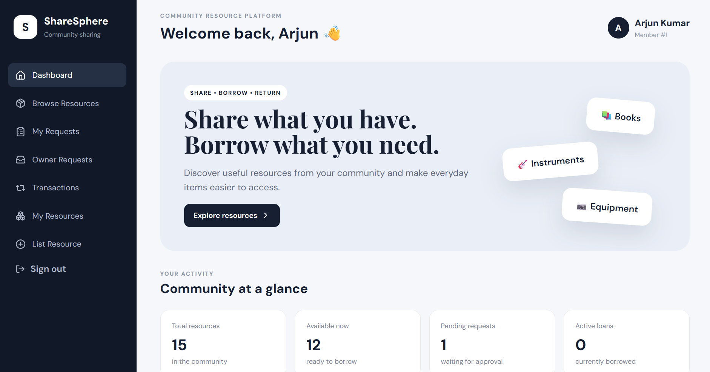
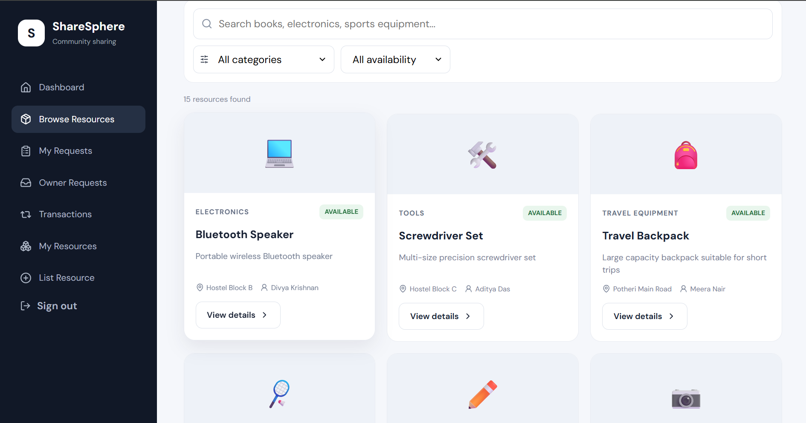
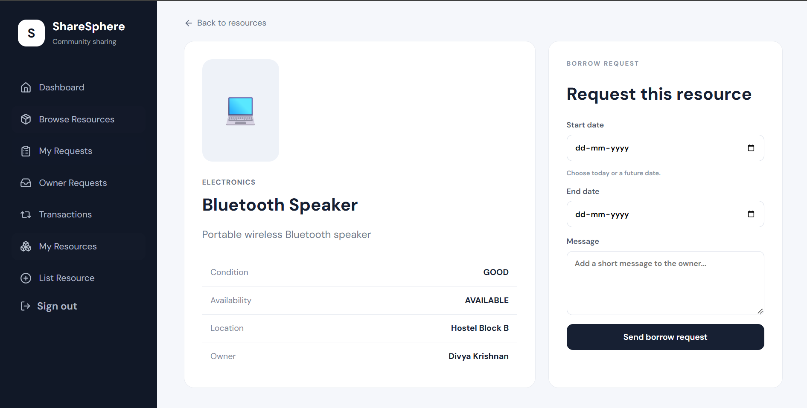
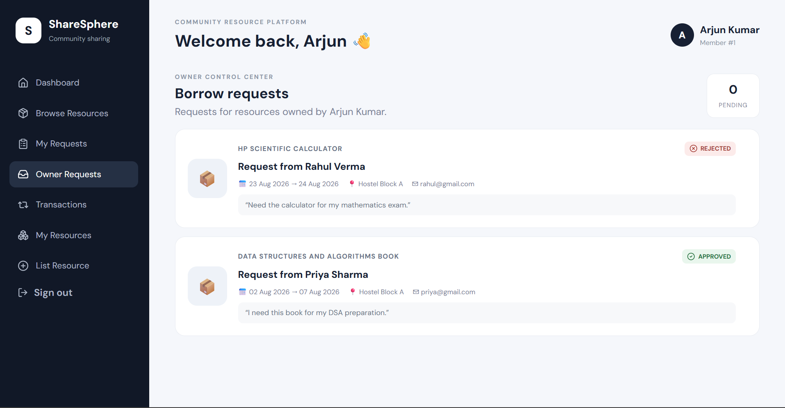
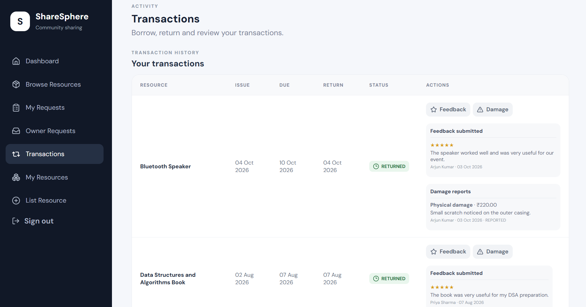

# ShareSphere
### Community Resource Sharing Platform

ShareSphere is a full-stack community resource sharing platform designed for college campuses and local communities. It allows users to list resources they own, discover available resources, request to borrow them, manage approvals, track transactions, return resources, provide feedback, and report damages.

## 🌐 Project Links

**Frontend Preview:**  
https://share-sphere-six.vercel.app

**GitHub Repository:**  
https://github.com/SarayuNarra/ShareSphere

> **Deployment status:** The frontend preview is hosted on Vercel. The backend and MySQL database were previously deployed on Railway, but the Railway trial has expired. Therefore, login and other backend-dependent features may not work on the hosted preview currently. The complete application can be run locally using the setup instructions below.

## ✨ Features

### User Authentication
- User registration and login
- Secure password hashing using Node.js `scrypt`
- Show password option
- Automatic migration of existing plaintext passwords to secure hashes

### Resource Management
- List resources for sharing
- Browse available resources
- Search resources
- Filter by category and availability
- View detailed resource information
- Manage resource availability
- Mark resources as available or under maintenance

### Borrowing Workflow
- Submit borrow requests
- View personal requests
- Resource owners can approve or reject requests
- Create borrowing transactions
- Track active and returned transactions
- Validate borrowing and return dates

### Feedback and Damage Reporting
- Submit 1–5 star ratings
- Add feedback comments
- Report resource damage
- Record estimated damage cost
- Track damage report status

## 🗄️ Database Features

- Normalized relational database design up to 3NF
- Primary keys and foreign keys
- UNIQUE, NOT NULL, and CHECK constraints
- Indexes
- SQL Views
- Stored Procedures
- Triggers
- Transactions using COMMIT and ROLLBACK
- SAVEPOINT and ROLLBACK TO SAVEPOINT

## 🛠️ Tech Stack

| Layer | Technologies |
|---|---|
| Frontend | React, Vite, JavaScript, CSS |
| Backend | Node.js, Express.js, REST APIs |
| Database | MySQL |
| Deployment | Vercel (Frontend), Railway (previous Backend and MySQL hosting) |

## 🏗️ System Architecture

```text
       React + Vite Frontend
                |
                | REST API
                v
       Node.js + Express Backend
                |
                | MySQL Connection
                v
          MySQL Database
```

## 📸 Screenshots

### Dashboard
Overview of community resources, availability, pending requests, and active loans.



### Browse Resources
Search and filter resources by category and availability.



### Resource Details and Borrow Request
View resource details and submit borrowing requests.



### Owner Requests
Owners can review incoming requests and approve or reject them.



### Transactions
Track borrowing and return transactions, submit feedback, and report damage.



## 💻 Run the Project Locally

### Prerequisites
- Node.js and npm
- MySQL Server
- MySQL Workbench (recommended)

### 1. Clone the repository

```bash
git clone https://github.com/SarayuNarra/ShareSphere.git
cd ShareSphere
```

### 2. Set up the database

- Open MySQL Workbench.
- Create a database named `sharesphere`.
- Import and execute the `ShareSphere.sql` file from the project folder.

### 3. Configure and start the backend

Open a terminal:

```bash
cd backend
npm install
```

Create a `.env` file inside the `backend` folder:

```env
DB_HOST=localhost
DB_USER=your_mysql_username
DB_PASSWORD=your_mysql_password
DB_NAME=sharesphere
PORT=5000
```

Start the backend:

```bash
npm run dev
```

### 4. Configure and start the frontend

Open a second terminal:

```bash
cd frontend
npm install
```

Create a `.env` file inside the `frontend` folder:

```env
VITE_API_URL=http://localhost:5000/api
```

Start the frontend:

```bash
npm run dev
```

### 5. Open the application

Visit:

http://localhost:5173

Keep the MySQL server and both terminal processes running while using the application.

## 🔐 Demo Credentials

| User | Email | Password |
|---|---|---|
| Arjun | arjun@gmail.com | password123 |
| Divya | divya@gmail.com | password123 |

## 🎯 Project Objective

The goal of ShareSphere is to encourage resource sharing within communities by providing a centralized platform for listing, borrowing, approving, returning, and managing shared resources.

This project provided practical experience in full-stack development, REST API integration, authentication, relational database design, SQL programming, and application deployment.
